# AskLens — Autonomous AI Data Analyst Platform

AskLens is a full-stack, open-source AI Data Analyst & Data Scientist platform. Ask questions by **text or voice** (English, Hindi, Gujarati), and AskLens plans the analysis, generates safe read-only PostgreSQL queries, executes sandboxed Python statistics, and streams back executive insights with interactive charts, tables, and the exact SQL used.

---

## Architecture

```mermaid
flowchart LR
    U[User: Text / Voice] --> STT[faster-whisper STT]
    STT --> IR[Intent Router]
    IR -->|clarify / unsafe / chitchat| SSE[SSE Stream]
    IR -->|simple / deep_analysis / forecast| CTX[Context Layer: Semantic YAML + Golden RAG + Memory]
    CTX --> PLAN[Senior Analyst Planner]
    PLAN --> SQLGEN[SQL Generator + Self-Correction]
    SQLGEN --> VAL[sqlglot AST Validator + RBAC]
    VAL --> EXEC[Read-Only Postgres + RLS + EXPLAIN Cost Gate]
    EXEC --> PII[PII Masker]
    PII --> STATS[Sandboxed Python Stats + Chart Recommender]
    STATS --> SYN[Executive Insight Synthesizer]
    SYN --> SSE
```



---

## Key Capabilities

- **Multi-Provider Free LLM Layer**: Supports Google Gemini (`gemini-3.5-flash`), local Ollama (`qwen2.5-coder` / `llama3.1`), and OpenAI-compatible endpoints (Groq / OpenRouter) with exponential backoff and automatic fallback.
- **SQL Safety (Non-Negotiable)**:
  - `sqlglot` AST validation: single `SELECT` (CTEs allowed), blocks DDL/DML, `pg_catalog`, `information_schema`, `app` schema, and dangerous functions (`pg_sleep`, `dblink`, `lo_*`).
  - Automatic `LIMIT` injection/capping + `EXPLAIN (FORMAT JSON)` cost threshold gate.
  - Dedicated `warehouse_readonly` Postgres role inside `READ ONLY` transactions with `statement_timeout`.
- **Governance, RBAC & RLS**:
  - `api/config/roles.yaml` (`admin`, `analyst`, `sales_manager`) enforced at AST level and Postgres Row-Level Security (RLS).
  - Automatic PII column masking (`email`, `phone`, `first_name`, `last_name`) before data reaches LLM prompts or UI.
  - Async audit logging to `app.audit_logs`, sliding-window rate limiting, Auth.js JWT authentication, and `/admin` Governance Console.
- **Senior Analyst Analytics**:
  - Period-over-Period comparison, Z-Score & IQR anomaly detection, Holt-Winters forecasting, and isolated Python subprocess sandbox.
  - Automatic Apache ECharts selection (Line, Bar, Donut, Scatter) + CSV export + browser `speechSynthesis` TTS.

---

## Quickstart (Under 15 Minutes)

### 1. Configure Environment
```bash
cp .env.example .env
# Add your GEMINI_API_KEY (or set LLM_PROVIDER=ollama)
```

### 2. Start PostgreSQL + Services via Docker Compose
```bash
docker compose up -d db
# Seed 24 months of realistic e-commerce data (including the Gujarat Q3/Q4 dip)
cd api
pip install -r requirements.txt
python seed/seed_warehouse.py
```

### 3. Run Backend & Frontend Locally
**Backend (FastAPI):**
```bash
cd api
uvicorn app.main:app --reload --port 8000
```

**Frontend (Next.js):**
```bash
cd web
npm install --legacy-peer-deps
npm run dev
```
Open [http://localhost:3000](http://localhost:3000) and ask:
> *"Why did sales drop in Gujarat last quarter?"*

Visit [http://localhost:3000/admin](http://localhost:3000/admin) for the **Audit & Governance Console**.

---

## Testing & Evaluation

### Backend Unit & Security Tests
```bash
PYTHONPATH=api python -m pytest api/tests/ -v
```

### Evaluation Benchmark (42 Cases)
```bash
# Offline heuristic + SQL safety benchmark
PYTHONPATH=api python -m eval.run --offline

# Live benchmark (requires PostgreSQL + LLM)
PYTHONPATH=api python -m eval.run --live
```

### Frontend Typecheck & Smoke Tests
```bash
cd web
npm run typecheck
npm test
```
